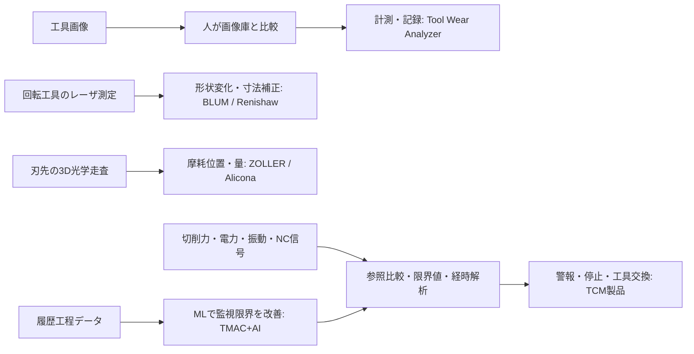

# 海外主要製品の詳細シート

調査基準日：2026-10-20（Asia/Tokyo）。本資料は公開一次資料を用いた技術整理であり、型式ごとの購入条件は未確認。特定のAI名称を確認できない場合は補完しない。資料の検索抜粋と本文確認は別管理する。

## P0101 Sandvik Coromant — Tool Wear Analyzer

スマートフォンで撮影した工具画像を画像庫と比較し、摩耗を計測・保存・共有する支援アプリ。

| 項目 | 確認内容 |
|---|---|
| 工具・加工 | 切削工具（個別形状未確認） |
| 加工法 | 未確認 |
| 入力 | 工具写真・参照摩耗画像庫 |
| 出力 | 摩耗計測、画像比較、保存・共有 |
| 判定原理 | 画像庫との目視比較および計測支援。自動AI判定は確認できない |
| 実装モデル | 人による画像比較・摩耗計測支援 |
| 関連研究モデル | 未確認 |
| 性能 | 未確認 |
| 速度 | 未確認 |
| 必要設備 | スマートフォン、装着顕微鏡を推奨 |
| 限界 | 画像比較・計測支援の記述から自動摩耗分類と解釈しない |
| 確度・区分 | A |

**エビデンス**：CG001、CG002、CG003、CG004、CG005、CG006。対応箇所は `evidence/claim_evidence.csv` を参照。

- [SG001 Tool Wear Analyzer – About this app](https://play.google.com/store/apps/details?hl=en&id=com.sandvik.coromant.toolwear)：About this app; Updated on。公式製品ページ確認。

## P0102 Sandvik Coromant — CoroPlus ProcessControl

切削中のセンサ信号から摩耗・欠損・衝突等を検知し、機械停止等を実行する監視システム。

| 項目 | 確認内容 |
|---|---|
| 工具・加工 | 旋削インサート/突切り工具（事例）；他形状未確認 |
| 加工法 | 旋削（事例） |
| 入力 | 加工力・振動・電力・トルク・駆動データ |
| 出力 | 摩耗検知・欠損検知・機械停止/工具交換 |
| 判定原理 | センサ入力を経時解析し摩耗を検知 |
| 実装モデル | 時系列センサ解析（具体判定アルゴリズム未確認） |
| 関連研究モデル | 未確認 |
| 性能 | 未確認 |
| 速度 | リアルタイム監視。カタログにミリ秒動作記述 |
| 必要設備 | 制御盤監視機器、用途別センサ、NC/HMIソフト |
| 限界 | 摩耗種類分類・VB直接測定・AIモデル未確認 |
| 確度・区分 | D |

**エビデンス**：CG007、CG008、CG009、CG010、CG011、CG012、CG013、CG014、CG015。対応箇所は `evidence/claim_evidence.csv` を参照。

- [SG002 CoroPlus ProcessControl, C-1040:269 en-GB](https://pdf.directindustry.com/pdf/sandvik-coromant/coroplus-processcontrol/14460-991142.html)：カタログp.4–8。公式カタログWeb本文確認。
- [SG003 New solution boosts metalworking efficiency](https://www.annualreport.sandvik/en/2018/operations/sandvik-machining-solutions/customer-case.html)：Real time monitoring; Benefits weigh in。公式製品ページ確認。

## P0103 Blum-Novotest — LC50-DIGILOG（LC-VISION併用）

機内レーザ遮光測定で工具形状・刃先状態を評価。ソフトで摩耗を可視化。

| 項目 | 確認内容 |
|---|---|
| 工具・加工 | ドリル、フライス工具、タップ、リーマ（形状別詳細未確認） |
| 加工法 | フライス加工・穴あけ・ねじ切り |
| 入力 | レーザ遮光量の連続測定値 |
| 出力 | 長さ・半径・輪郭変化、摩耗補正 |
| 判定原理 | レーザ遮光を連続測定し工具輪郭変化を計測 |
| 実装モデル | DIGILOG連続レーザ計測 |
| 関連研究モデル | 未確認 |
| 性能 | 150 mm仕様の繰返し性0.2 μm 2σ。摩耗分類正解率ではない |
| 速度 | 毎秒数千測定値（工具監視所要時間とは異なる） |
| 必要設備 | CNC対応計測サイクル、機内レーザユニット、清掃/保護空気 |
| 限界 | 技術サイクルは選定NCのみ。汚れ除去/固定安定性が必要 |
| 確度・区分 | A |

**エビデンス**：CG016、CG017、CG018、CG019、CG020、CG021、CG022、CG023、CG024、CG025。対応箇所は `evidence/claim_evidence.csv` を参照。

- [SG004 LC50-DIGILOG](https://www.blum-novotest.com/us/products/measuring-components/lasercontrol/lc50-digilog/)：Highlights; BLUM standard measuring cycles; Technical data。公式製品ページ確認。
- [SG025 50 years of measuring technology](https://www.blum-novotest.com/fileadmin/benutzerdaten/blum-novotest-de/pdf/downloads/allgemein/b-n-news/2018/blum-novotest-news-2018-en.pdf)：PDF p.3, 2017 unveil。PDF本文確認。
- [SG026 Adapt or fail?](https://www.blum-novotest.com/fileadmin/benutzerdaten/blum-novotest-de/bilder/news/2019/uk/blum-uk-adapt-or-fail-white-paper.pdf)：The birth of the solution（2018 revealed）。PDF本文確認。

## P0106 E. ZOLLER — edgeControl

3DセンサとCNC軸で刃先を走査し、摩耗/欠損を自動計測する工具検査装置。

| 項目 | 確認内容 |
|---|---|
| 工具・加工 | 切削工具（エンドミル形状別対応未確認） |
| 加工法 | 未確認（工具再研削・検査用途） |
| 入力 | 工具刃先3D画像 |
| 出力 | 3D摩耗位置と量・欠損測定 |
| 判定原理 | 3D刃先デジタイズとpilot 4.0自動解析 |
| 実装モデル | 3D走査・画像処理/自動形状解析 |
| 関連研究モデル | 未確認 |
| 性能 | 未確認 |
| 速度 | 未確認 |
| 必要設備 | 専用光学工具測定機とpilotソフト |
| 限界 | 刃先を光学走査できる設置・測定が必要。判定精度の共通評価未確認 |
| 確度・区分 | A |

**エビデンス**：CG043、CG044、CG045、CG046、CG047。対応箇所は `evidence/claim_evidence.csv` を参照。

- [SG007 genius brochure](https://www.zoller.info/fileadmin/DATA/_US/Produkt_PDFs-us/genius-brochure_US-ZOLLER.pdf)：PDF p.19–20（誌面38–41）edgeControl。PDF本文確認。

## P0108 Caron Engineering — TMAC（Tool Monitoring Adaptive Control）

加工センサから摩耗・欠損を監視し送りを適応制御。2026資料にAI追加モジュール。

| 項目 | 確認内容 |
|---|---|
| 工具・加工 | 切削工具（個別形状未確認） |
| 加工法 | 未確認（CNC切削） |
| 入力 | 工具負荷、振動、ひずみ、流量/圧力等 |
| 出力 | 警報/停止・監視限界値調整 |
| 判定原理 | 負荷/信号の安全限界比較、AIモジュールは過去データから監視限界値を自動設定/改善 |
| 実装モデル | 閾値監視・適応送り制御；AI追加機能のML系統は未確認 |
| 関連研究モデル | 未確認 |
| 性能 | 未確認 |
| 速度 | リアルタイム監視/ミリ秒単位の送り最適化をカタログ記載 |
| 必要設備 | CNC接続・センサ・独立処理装置 |
| 限界 | AIモジュールのモデル・訓練/テスト分割・独立評価未確認 |
| 確度・区分 | C |

**エビデンス**：CG056、CG057、CG058、CG059、CG060、CG061、CG062。対応箇所は `evidence/claim_evidence.csv` を参照。

- [SG009 TMAC TOOL MONITORING ADAPTIVE CONTROL V02.2026](https://www.caroneng.com/wp-content/uploads/TMAC-Brochure-V02.2026.pdf)：PDF p.4 TMAC + AI; p.1–3。PDF本文確認。

## P0109 pro-micron（Sandvik Coromant傘下） — spike / fusion（PROCESS AUTOMATION・INSIGHTS）

工具ホルダ力信号と機械データをfusionで統合し、摩耗トレンドを監視。

| 項目 | 確認内容 |
|---|---|
| 工具・加工 | フライス工具、ドリル、リーマ（資料例） |
| 加工法 | フライス加工・穴あけ・旋削・ねじ切り等（技術資料） |
| 入力 | 力/曲げモーメント・NC/機械データ・外部データ |
| 出力 | Wear Trend Detection；INSIGHTS PROにTHI/RUL Calculator（精度未確認） |
| 判定原理 | fusionで工程変数にルール/限界値を設定して異常時に機械応答 |
| 実装モデル | 力計測、限界値ルール、摩耗傾向監視 |
| 関連研究モデル | 未確認 |
| 性能 | 未確認 |
| 速度 | 未確認 |
| 必要設備 | fusion Edge/Server/Machine Interface/Analysis/Monitoring、機能別追加センサ |
| 限界 | RUL Calculator搭載の記載と未知工具に対する寿命予測精度を区別 |
| 確度・区分 | A |

**エビデンス**：CG063、CG064、CG065、CG066、CG067、CG068。対応箇所は `evidence/claim_evidence.csv` を参照。

- [SG010 Process monitoring with PROCESS AUTOMATION](https://www.pro-micron.de/en/solutions/process-automation/)：FAQ: How does; data; wear trends。公式製品ページ確認。
- [SG011 spike Solutions](https://www.pro-micron.de/en/solutions/)：PROCESS INSIGHTS PRO; PROCESS AUTOMATION; Required Equipment。公式製品ページ確認。
- [SG029 pro-micron home](https://www.pro-micron.de/en/)：part of Sandvik Coromant; Kaufbeuren。公式製品ページ確認。
- [SG012 Patented cutting force measurement](https://www.pro-micron.de/wp-content/uploads/2021/12/spike%C2%AE-Technologie1.2-Vers.-2-EN.pdf)：Technology/assistline/automation。検索結果抜粋のみ。

## P0114 Bruker Alicona — EdgeMaster + WearMeasurementModule

3D光学計測で切れ刃と摩耗量を自動測定する工具計測装置。

| 項目 | 確認内容 |
|---|---|
| 工具・加工 | 切削工具（HOBはシリーズ別。工具形状別詳細未確認） |
| 加工法 | フライス加工（ISO 8688対応計測） |
| 入力 | 3D光学形状・表面データ |
| 出力 | ISO 8688の摩耗パラメータ/差分パラメータ |
| 判定原理 | Focus-Variationで3D形状取得し、WearMeasurementModuleで摩耗量評価 |
| 実装モデル | Focus-Variation 3D計測 |
| 関連研究モデル | 未確認 |
| 性能 | 未確認 |
| 速度 | 未確認 |
| 必要設備 | EdgeMaster、対応対物レンズ/軸、摩耗解析モジュール |
| 限界 | 縦分解能はレンズに依存。VB誤差・摩耗分類正解率とは異なる |
| 確度・区分 | A |

**エビデンス**：CG096、CG097、CG098、CG099、CG100、CG101、CG102。対応箇所は `evidence/claim_evidence.csv` を参照。

- [SG019 EdgeMaster Series](https://www.alicona.com/en/products/edge-master-series)：Wear Measurement; Technical specifications。公式製品ページ確認。

## 方式の独自概念図

次は本調査で整理した概念図であり、原資料図版の転載ではない。具体的内部AIアーキテクチャを表さない。

## 解釈上の重要点

- Tool Wear Analyzerの画像庫比較は、公開説明上の人による判断支援。自動AI分類の根拠とはならない。
- レーザ繰返し性、3D縦分解能、電力分解能は、VB推定誤差・摩耗分類Accuracyとは異なる。製品間ランキングには使わない。
- TMACの2026カタログはAI追加機能の機械学習を明示するが、具体的モデル名や独立検証を確認できない。
- pro-micronのRUL Calculatorは製品機能名として確認した。未知工具でのRUL誤差や信頼区間が実証されたという意味ではない。
- 原資料の構成図参照先はZOLLERカタログPDF p.19–20、Kistler発表PDF p.1–2、TMACカタログPDF p.4、spike/fusion公式FAQ。転載は行っていない。

