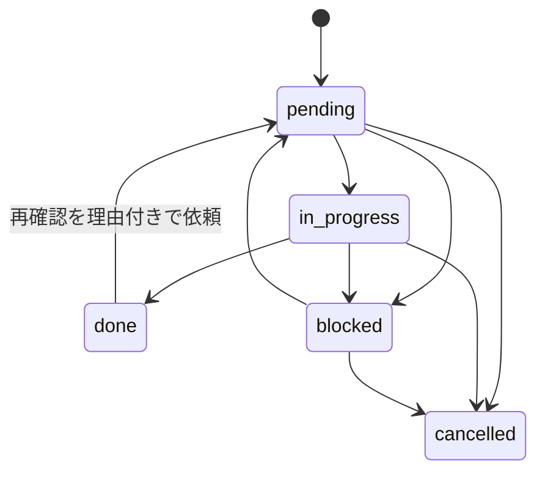

# 文献調査キットの設計

このキットは、調査の現在地と次の作業をプロジェクト内へ保存する。検索結果、未取得の順位、採否、PDFの保存、読了、根拠の抽出、引用追跡、ユーザーの指示を参照できるため、チャットを替えても同じ調査を続けられる。

入力・出力・対象・採否条件はテーマごとに `project.json` へ設定する。研究分野、検索DB、最低論文数、特定モデルの利用を共通の必須条件にしない。既存の工具摩耗調査は利用例とし、その語彙や採否条件は新規テーマへ自動継承しない。

## 保存形式と責任範囲

Python CLI、JSON、UTF-8 CSV、単体HTMLで構成する。検索・本文取得・内容判断はエージェントが利用可能な公式API、コネクタ、検索画面、公開リポジトリ等で実行する。実行結果を `ingest` で受け取り、表と履歴を更新する。HTMLを開くためのサーバーは不要である。

```text
<project>/
  project.json
  tables/
    queries.csv
    runs.csv
    hits.csv
    papers.csv
    evidence.csv
    tasks.csv
    citation_checks.csv
    known_items.csv
  history/
    events.jsonl
    checkpoints/
  outputs/
    status.json
    dashboard.html
    next_actions.csv
    next.json
    audit.json
```

`project.json` と8つのCSVを現在の状態の保存先とする。`history` は更新の経緯を、`outputs` は表示・判断用の生成結果を保持する。本文ファイルやAPIの原応答を保存した場合は、保存先を `local_path` または `raw_path` に記録する。保存できなかった理由も台帳へ残す。

正式な列と列挙値は [schema.json](schema.json)、初期設定は [templates/project.json](templates/project.json) を参照する。

| 表 | 1行の単位 | 主な用途 |
| --- | --- | --- |
| queries | 計画した検索式 | DB・フィールド・条件・目的・取得予定量 |
| runs | 1回の検索実行・ページ取得 | 実時刻・総数の確度・順位範囲・実行URL・原応答 |
| hits | 検索実行で返った1結果 | 未選別を含む全返却結果と論文IDの対応 |
| papers | 同定した1論文・同一work | 採否・確認深度・保存・読了・抽出・優先度 |
| evidence | 論文から抽出した1事項 | 原語・値・単位・条件・位置・確認状態 |
| tasks | 1つの作業指示 | ユーザー依頼・担当作業・状態・完了根拠 |
| citation_checks | 1論文の方向別・範囲別の引用確認 | 前方／後方、索引、件数確度、確認範囲 |
| known_items | 既知論文を検索式で探す1確認 | DB収録有無、発見run、事前／事後登録 |

## IDと変更履歴

`query_id`、`run_id`、`hit_id`、`paper_id`、`evidence_id`、`task_id`、`check_id`、`test_id` はプロジェクト内で一意にする。例えば `Q0001`、`R0001`、`H000001`、`P0001` を使用できる。並べ替えやタイトル修正でIDを付け直さない。プロジェクトをまたぐ参照は `project_id` と組み合わせる。

DOIは表記揺れを整えて照合し、arXiv IDと出版社版の関係も記録する。同一workと確認できれば同じ論文へ発見経路を結び付ける。題名一致だけの場合は `title_match_unverified` を保持する。改題・著者増減・追試・発展版は、同一性を確認してから統合する。

論文を統合しても、複数のDBや検索式から得たhitsは残す。検索結果の延べ数、重複を除いた論文数、採用論文数をそれぞれ算出できる形にする。

`ingest`、`update`、`configure`、`request`、`import-requests` 等による変更は、実時刻、対象、変更内容、理由を履歴へ残す。CSVを直接編集したときは `checkpoint --reason` により記録する。事後記録を、過去時点に実施した検索や判定として表示しない。履歴とチェックポイントは再開・差分確認に使い、自動的な巻き戻し操作とは扱わない。

## 検索実行と残る範囲

検索式には、文字列に加えてDB、検索対象フィールド、期間・言語等のフィルター、並び順を保存する。1回の取得は1つのrunとして記録する。検索式が同じでも、索引時点や並び順が変わった取得は別の `search_set_id` とする。

`runs.semantics` は、意図した検索の実行を確認した `checked`、条件の解釈が不確かな `uncertain`、意図した条件を実行できなかった `invalid` を区別する。HTTP成功だけで検索条件の適用まで確認済みにしない。

| 総数の状態 | 記録 | 残範囲の読み方 |
| --- | --- | --- |
| DBが正確な総数を返す | `exact` と数値 | 同じ検索集合内の未取得順位を算出できる |
| 「約○件」等の概数 | `approximate` と表示値 | 概数と取得済み範囲を併記する |
| 総数が返らない・取得失敗 | `unknown`、総数は空欄 | 総数と未取得総数は不明 |
| DBが0件と明示 | `exact`、総数0 | その検索式・時点の検索結果は0件 |

エラー、認証要求、空応答を0件へ置き換えない。診断用・失敗・重複runは、確認済みの新規取得として加算しない。

結果未取得の失敗runでは総数・取得開始順位・返却件数を空欄にし、JSONから取り込む場合は `null` を使う。要求した件数は `requested_count` に保持できる。取得成功でDBが0件と明示したrunには、総数と返却件数の0を記録できる。

取得済み範囲は `query_id + search_set_id` 内のhitsの順位を集合として集計する。同じページを再取得した順位は二重計上しない。例えば総数100件で1–10位と21–30位を取得した場合、予定範囲1–30位に残るのは11–20位である。返却件数20を連続1–20位取得と解釈しない。

全体の総数と、今回予定した `planned_limit` までの残範囲を両方示す。取得上限を超える部分は未実施として見える状態にする。カーソル方式で絶対順位を確定できない場合は、カーソルと取得件数を保持し、順位の厳密な充足は未確認とする。

## 論文の状態

取得、読了、抽出、採否は独立した状態である。各状態を変更する際に、実施内容と根拠を付ける。

| 軸 | 状態と変更の目安 |
| --- | --- |
| 採否 | `unreviewed` から `potential` / `include` / `exclude` / `hold` へ。追加根拠や条件変更による再判定も理由を残す |
| アクセス | `unknown` から、確認できた `metadata` / `abstract` / `online_fulltext`、または `blocked` / `not_found` へ |
| 保存 | `not_attempted` から `saved` / `failed` / `not_saved` へ。`saved` は実在するファイルと対応させる |
| 読了 | `not_started`、`metadata`、`abstract`、`partial_text`、`sections`、`full` で実際の確認深度を記録 |
| 抽出 | `not_started` から `partial`、指定項目を確認した後に `complete` へ |
| 引用追跡 | 前方・後方ごとに `not_started` / `partial` / `complete` / `blocked` / `not_applicable` を記録 |

PDFの保存だけで `reading_status=full` へ進めない。オンライン全文を読めれば保存なしでも読了を記録できる。必要な節・表を読み終えて指定項目を抽出した場合は、`reading_status=sections` と `extraction_status=complete` が成立し得る。読了済みでも抽出が未完了の場合は、その状態を保持する。

`hold` は情報不足等による採否保留で、`exclude` とは別に集計する。題名・抄録による判断にはその確認深度を記録し、本文で確認した値と同じ確度を付けない。

## 指示と作業の状態機械



指示は論文・検索式・プロジェクトのいずれかへ結び付ける。`amount` は作業量の指定で、本文取得なら対象本数、追加検索なら追加取得件数など、理由欄と合わせて単位を読めるようにする。優先度は1が最高、5が最低である。

`done` には実際の `completed_at` と `evidence_ref` を記録し、作業種別に対応する論文・検索の状態も更新する。例えば読了作業を完了にしたのに対象論文が未読であれば、状態の不整合として監査する。

HTMLは指示をJSONとしてダウンロードする。`import-requests` はそれを `pending` tasksへ追加する。実際に検索・本文取得・読了・抽出が終わったとき、結果のrunやevidence等を `evidence_ref` へ記録して完了に進める。指示ファイルの作成・取込と研究作業の完了は、それぞれ表示する。

指示の再取込は `request_id` で照合する。省略時は指示内容のハッシュから安定IDを補う。同じ指示ファイルの再取込でtasksを増やさず、既存の完了状態も戻さない。内容が同じ別作業を依頼するときは別IDを与えるか、独立指示を作る `request` コマンドを使う。

ユーザーの未完了指示を自動提案より優先する。履行できない指示は `blocked` と理由を記録し、他の実施可能な作業を続ける。対象範囲や予算の変更があれば設定と理由を履歴へ残す。

## 読む順番の優先点

優先点は読む順番の候補を作るために使う。研究の品質、正しさ、採用確率、発見確率は表さない。ユーザーが明示した順番やtasksを先に反映する。

論文の `user_priority` と検索式の `priority` は、空欄の場合に通常の3を使う。これは作業順の既定値である。関連度・年・引用数の欠測には下記の未評価表示を適用する。

既定の寄与率は関連度65%、新しさ25%、年当たり引用数10%とする。関連度は0–3で、0は範囲との関連が確認できない、1は周辺、2は目的の一部に適合、3は直接適合という判断と理由を記録する。未判定は空欄にする。

```text
age = max(0, 基準年 − 発表年)
r = relevance / 3
y = max(0, 1 − age / recency_years)
rate = citation_count / max(1, 基準年 − 発表年 + 1)
c = min(1, rate / citation_rate_cap)
既知寄与点 = 100 × (0.65 × r + 0.25 × y + 0.10 × c) のうち評価可能な項の合計
未評価の重み = 評価不能な項の重みの合計
上限 = 既知寄与点 + 100 × 未評価の重み
```

年や引用数が不明なら対応する項を未評価とする。引用数0が確認済みの場合は評価済みの0である。欠測項を除いて重みを再配分しない。例えば関連度3だけが分かる論文は、既知寄与65点・未評価35%・上限100点と表示する。入力率は必要な項目の充足度である。

引用数には取得元と確認日を添える。引用数が分かっていても、その取得元・確認日が欠ける場合は引用項を未評価とする。引用DB、収録分野、公開期間が異なる数を同じ品質尺度として扱わない。発表年が基準年より未来の場合等の不整合は監査対象とする。

自動提案枠の既定配分は優先点60%、新しい研究20%、探索20%である。既出候補を重複選択しない。探索枠は未評価・低引用・未充足のカテゴリにも作業を振り向ける。乱数seedと設定を保持し、配分、重み、期間、cap、バッチ量は調整可能にする。

## 見込みと終了判断

候補率は `(include + potential) / (include + potential + exclude)` で算出する。`hold` と `unreviewed` は母数から外し、それぞれ別に件数を示す。母数が10未満の場合は見込み不明とする。`potential` を含む率を最終採用率と呼ばない。

率を示すときはDB、検索式、検索集合、順位範囲、判定済み件数、保留・未判定数を併記する。上位の関連度順の結果から、未取得全体の論文数や有望論文数を外挿しない。別順位帯・別クエリ・別カテゴリの結果を確認して、追加探索の収穫と投入量を記述する。

| 残る作業 | 判明している範囲 |
| --- | --- |
| 未取得順位 | 同じ検索集合内で取得していない既知の順位 |
| 未選別 | 取得済みhitsに対応する未判定論文 |
| 本文未取得 | 読む対象に選んだ論文のアクセス・保存残件 |
| 未読・抽出未完了 | 登録済み論文の状態から分かる作業 |
| 引用未追跡 | 選定seedの方向別・予定深度の残作業 |
| 未発見文献 | 未使用語・未検索DB・索引漏れ等による未知の範囲 |

既知の残作業は件数を示せる。未発見文献の総数や全世界に対する網羅率は、この台帳からは算出できない。

終了時は設定した必須検索、予定取得範囲、対象内未選別、必要な読了・抽出項目、seed引用追跡、ユーザーtasksを点検する。満たした予定範囲、取得制約による残件、打切りの理由を報告する。`audit` のPASSは台帳の整合性を示す。調査の完全網羅を証明するものとは扱わない。

`quick` / `standard` / `deep` は本設計が定める変更可能な初期値である。

| mode | 1式の取得目標 | 選別バッチ | 読むバッチ | 引用seed目標 | 引用深度 |
| --- | --- | --- | --- | --- | --- |
| quick | 20 | 10 | 3 | 3 | 1 |
| standard | 100 | 25 | 5 | 10 | 1 |
| deep | 300 | 50 | 10 | 20 | 2 |

これらの量に到達した後も、未充足の重要カテゴリやユーザー指示があれば残作業として表示する。

## エビデンスと比較条件

重要な主張には `evidence_id` を付け、原資料のURL、節・ページ・表・図、値、単位、実験条件、確認深度へ結び付ける。数値が不明なら不明として保持する。資料間の矛盾は、出典・版・日付とともに記述する。

比較表では、研究目的、対象集団・材料・工具、入力、出力ラベル、データ規模、評価分割、指標の定義と平均法、ベースライン、外部検証の有無を確認する。モデル名や高い精度だけで順位を付けない。画像の正常／異常、欠陥種類、程度、回帰量、寿命予測は、そのテーマの分類体系に従って識別する。商用製品への搭載と関連研究の技術も区別する。

## 参照した一次資料と本設計の選択

検索式・情報源・実行日・件数・制限・重複排除の追跡性は、PRISMA-Sの報告指針を参照した。[PRISMA-S公式案内](https://www.prisma-statement.org/prisma-search)、[PRISMA-S説明論文](https://doi.org/10.1186/s13643-020-01542-z)

検索範囲を計画し、複数の経路と既知研究を用いて検索を評価・記録する考え方は、Cochrane Handbook第4章を参照した。[Cochrane Handbook 第4章](https://training.cochrane.org/handbook/current/chapter-04)

引用数等を個別研究の品質の代用にしない扱いは、DORAを参照した。[DORA宣言](https://sfdora.org/read/)

分野横断への適用、8表、状態の分離、65/25/10の優先点、60/20/20の作業配分、母数10の表示条件、modeの初期量は、このキット独自の設計選択である。参照資料が同じ数値・構成を要求しているという位置付けにはしない。
