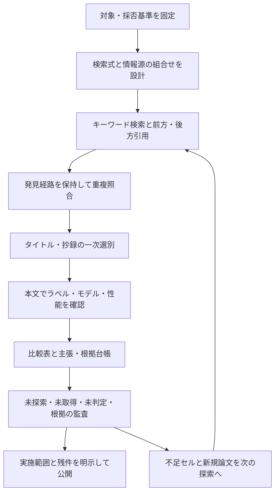

# 再利用する文献探索の手順

目的は、取りこぼしを減らす探索と、その実施範囲を後から検証できる記録を両立すること。検索件数だけで「網羅済み」と判定しない。以下は技術ベンチマーク向けに設計した運用手順であり、特定の報告規格への完全準拠を宣言するものではない。

## 1. 探索前に決めること

目的、対象、入力、出力、モデル、期間、言語、地域、文献種別、採用／除外例、基準日を一枚の仕様に固定する。変更は理由と日付を残す。正常／異常、程度、種類、量、領域、寿命は別タスクとして定義する。

既知の適合論文を、年代・研究グループ・対象・モデルを分散させてseedに選ぶ。新しく有望なクラスターが見つかったらseedを追加し、同じデータや同じ研究室への偏りを点検する。レビュー論文は候補発見に利用し、個々の性能は原著へ戻る。

## 2. 検索式と検索範囲を表にする

対象語、課題語、入力語、モデル語を別の語彙群にする。初めは広い検索式と、具体的なラベル・モデルを含む狭い検索式を併用する。すべての語群を必須ANDにすると名称の違う研究を落とすので、語群を一つ外した補完検索も実施する。

例：工具では `cutting tool / insert / drill / milling`、`wear type / damage mode / chipping / built-up edge`、`image / vision / microscopy`。工業では `defect classification / defect category / fault type / categorical anomaly / multi-label defect / defect question answering` と製品名・モデル名を組み合わせる。

検索マトリクスの各行に「対象×課題×モデル／産業×言語・年代」の探索枠を置く。必須の枠は、実行したquery IDか、未実施・取得制約の理由に結び付ける。「検索済み・適合例なし」は、実際の検索と採否確認を伴う場合にのみ使う。

## 3. 独立した探索経路を組み合わせる

| 経路 | 主な役割 | 注意点 |
|---|---|---|
| 学術データベース・会議・出版社 | 分野内の語彙検索、正式本文・書誌 | 検索可能フィールドと契約範囲、期間・件数上限を記録 |
| Crossref | DOI・出版日・出版社登録書誌・登録参考文献 | 全文の種類ラベルや性能を代替しない。登録情報の欠落がある |
| OpenAlex等の引用索引 | 前方・後方引用候補の列挙、別版・所属の手掛かり | 索引内の網羅と全世界の文献網羅は別。API件数・ページ末尾・基準日を記録 |
| Google Scholar・一般Web | 用語揺れ、著者版、未索引・最新文献を補う | 上位結果は全件取得ではない。ランキングや件数は変動する |
| J-STAGE・CiNii・機関リポジトリ | 国内・日本語・技術報告・著者版 | 英文題名のみでは見つからない研究を補う |
| 著者・データセット・公式コード | 後続研究、ラベル定義、実験の補足 | 研究者名やコード名だけで採用せず原著を確認 |

同じ索引を使う複数の検索画面は、完全に独立した経路ではない。アクセスできないデータベースを検索済みにしない。APIの `related_works` や類似検索は引用関係そのものではない。[Crossref公式REST API](https://www.crossref.org/documentation/retrieve-metadata/rest-api)、[OpenAlex公式引用取得例](https://help.openalex.org/how-to/api-recipes/)。

## 4. 検索結果と論文の採否を分離する

検索実行ごとに日時、provider、検索式、フィルタ、並び順、返却件数、全件数の有無、ページ範囲、保存先を記録する。一つの論文が複数経路に現れても、発見経路を消さずwork単位で統合する。

DOIを正規化し、arXiv版・会議版・出版版の対応を記録する。DOIがなければ題名・著者・年で手動確認する。類似題名を機械的に同一論文にしない。同じデータを使う別論文は残し、データ系列を紐付ける。

候補は「未選別→抄録確認→本文確認→採用／関連／除外／保留」と進める。除外理由は、出力が量・段階、画像を推論に使わない、対象モデル外、工業対象外、種類評価なし等を具体的に記す。情報不足は除外と同義ではなく保留とする。

## 5. 引用を両方向に追う

後方はseedの参考文献、前方はseedを引用した論文。原文の引用文脈も読んで、同じ課題か、一般的な背景引用かを区別する。各seedについて両方向の取得方法、取得可能件数、実際に確認した件数、残りを記録する。[Wohlinの原著](https://www.wohlin.eu/ease14.pdf)を参考にするが、ここでの台帳や監査条件は本プロジェクトの運用設計である。

新規採用論文にも必要に応じて同じ追跡を行う。今回は何段まで追ったかを示し、未処理の論文を次回の待ち行列に残す。「被引用数200」と「200本を取得・選別した」は別である。索引の前方引用が0でも、別の索引・著者版・未索引論文に後続がないとは言えない。

## 6. 本文と性能を確認する

出版社・会議公式・著者版・機関リポジトリ・補足資料を合法な経路で探す。アクセス失敗、要契約、抄録のみ、本文の該当節確認、全ページ確認を区別する。著者への連絡や有料購入は別途の判断とする。

種類ラベル、推論入力、実装モデル、性能指標、実数、評価単位、データ枚数、分割、未知条件、コード・データを抽出する。表や式の位置をClaimに紐付ける。AccuracyとPrecision、分類mAPと検出mAP、四択VQAと閉集合分類、正解ROIの有無を混ぜない。曖昧な高精度値は原図・混同行列・補足・コードで再確認する。

## 7. 探索の品質を監査する

既知の適合seedが検索式から再発見できるかを点検する。ただし、seed題名をそのまま検索した結果は検索式の感度検証には使わない。既知集合の再発見率はその集合に対する値であり、全文献に対する網羅率ではない。

採用は重要項目を再確認し、除外は決めたサンプルと境界事例を見直す。採否を変えた場合は旧判定を履歴に残す。別人による独立二重選別を実施していなければ、そのように表示する。機械チェックが検査できるのは参照・件数・状態の整合であり、論文の意味理解の正しさではない。

## 8. 終了と次回更新を判断する

次を別々に評価する：予定した検索枠の実行、取得集合の選別、seedの両方向追跡、重要保留の処理、根拠の充足、追加発見の推移。満たした範囲を明記し、未達を残す。

検索周回ごとの新規採用数・候補数・検索枠・投入範囲を残す。新規発見が減ったことは収束の手掛かりになるが、検索式が狭すぎるだけの場合もある。あらかじめ定めた枠を実行し、独立経路と新しいseedでも追加候補が少ないことを確認して初めて、限定した範囲の探索を一区切りにする。絶対的な「完全網羅」や根拠のない網羅率は出さない。

更新時は前回基準日以降の文献・改訂版と、保留・未処理引用を優先する。新規採用・除外変更・性能訂正を差分表にし、過去の成果を再現できるコミットを残す。

## 報告の根拠

検索式、情報源、日付、件数、重複排除等の報告は[PRISMA-Sの公式案内](https://www.prisma-statement.org/prisma-search)と[説明論文](https://doi.org/10.1186/s13643-020-01542-z)を参照した。PRISMA-Sは検索の報告指針であり、チェック項目が埋まるだけで探索の完全性が証明されるものではない。
