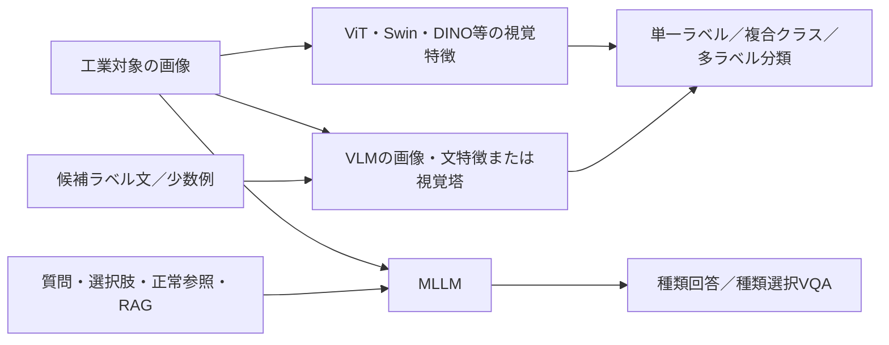

# 工業・産業の欠陥種類分類：Transformer・VLM・MLLMベンチマーク

調査基準日：2026-11-11（日本時間）。公開資料の確認に基づく調査版。工具摩耗の既存成果物とは別の拡張調査である。

## 1. エグゼクティブサマリー

**欠陥の種類をカテゴリとして答える28本を主比較対象とした。** 視覚Transformer11本、VLM／VLM由来特徴7本、MLLM10本。関連5本・保留5本を別に収録し、Excelは計38行。主比較のうちIT004は欠陥種類を匿名IDで表すため、名称の共通語彙比較には使えない。その他にも原語ラベルの全量一覧が未抽出の部分集合があり、各行に明記した。

[Excel](../outputs/industrial_defect_classification_benchmark.xlsx)／[CSV](../outputs/industrial_defect_classification_benchmark.csv)／[系統集計](../outputs/industrial_model_family_summary.csv)／[品質監査](industrial_defect_classification_audit.md)／[代表論文の詳細](../details/industrial_defect_classification/README.md)。

画像から傷・穴・汚染・短絡等を分類する研究は複数産業で確認できた。一方、画像の正常／異常を判定するAUROC、位置検出のmAP、VQA全体の平均を、欠陥種類の分類精度と読み替えることはできない。CLIP採用も、推論時に自然言語を使うことを必ずしも意味しない。

## 2. 調査目的・方法・範囲

工業製品、材料、部品の画像に基づく種類分類を対象とした。単一ラベル、複数ラベル、複合クラスを含む。画像だけでなく、候補ラベル、質問、プロンプト、参照画像、文献情報を入力する方式を収録した。純粋なCNNだけの研究、程度のみの分類、二値検知のみ、センサ／ログのみは主比較から分けた。種類付きbbox検出・画素分割は関連表に置いた。

出版社、国際会議の公開原著、著者版、arXiv、公式コード／データ定義、原著の引用を横断し、51行の検索・直接確認ログを残した。1行が複数クエリのバッチを含み、51個の独立した検索語を意味しない。全データベースの系統的検索や引用の完全追跡は未達である。仕様は[採否基準](industrial_defect_classification_scope.md)、原資料は[出典台帳](../evidence/industrial_defect_classification/sources.csv)を参照。

## 3. モデルと入力の分類

| 主モデル系統 | 主比較 | 関連 | 保留 |
|---|---|---|---|
| 視覚Transformer | 11 | 1 | 5 |
| VLM／VLM由来特徴 | 7 | 3 | 0 |
| MLLM | 10 | 1 | 0 |
| LLM（テキスト中心） | 0 | 0 | 0 |

モデルの名称と入力のモダリティを別軸で管理した。画像に正常参照画像を追加すること、画像にテキストを付けること、画像と物理センサを融合することは異なる。今回採用した研究で、画像と同時取得の非画像物理センサを融合して種類を分類する適合例は確認できなかった。LPBFのRAG論文も、評価入力は可視画像と文献の画像・文章であり、赤外線等の同時計測融合を実証した結果ではない（IM004）。

これは文献群を整理する独自概念図であり、個別モデルの構成図の転載ではない。すべての研究が図中の全入力を必要とするわけではない。

## 4. 視覚Transformerの研究

| ID・原著 | 年 | 主モデル | 原語クラス／粒度 | 種類分類の指標・条件 |
|---|---|---|---|---|
| [IT001: Hybrid Architecture Based on CNN and Transformer for Strip Steel Surface Defect Classification](https://www.mdpi.com/2079-9292/11/8/1200) | 2022 | CNN-T：4層畳み込み、パッチ埋込、2層Transformer encoder、MLP分類器 | cracks (Cr); inclusions (In); patches (Pa); pitted surface (PS); rolled-in scale (RS); scratches (Sc) | 学習80%：Accuracy 99.17%、precision 99.21%、recall 99.17%、F1 99.17%（10実験平均） |
| [IT002: Detection and classification of surface defects on hot-rolled steel using vision transformers](https://d-nb.info/1370185472/34) | 2024 | Keras/TensorFlowで実装したViT分類器（パッチ化＋自己注意＋MLP） | scratches (0); crazing (1); inclusion (2); patch (3); pitted surface (4); rolled-in (5) | 最良設定のTest accuracy 96.39%（347/360；Table 8とFig.17） |
| [IT003: Cross-Dataset Benchmarking of Deep Learning Models for Surface Defect Classification in Metal Parts](https://www.mdpi.com/2076-3417/16/6/3022) | 2026 | Swin Transformer; CoAtNet（新規提案モデルではない） | NEU-DET: Crazing; Inclusion; Patches; Pitted Surface; Rolled-in Scale; Scratches ／ X-SDD: finishing roll printing; iron sheet ash; oxide scale of plate system; oxide scale of temperature system; red iron; slag inclusion; surface scratch ／ MTDD: blowhole; crack; fray; break; uneven; non-defective surfaces | Swin：NEU-DET Acc/F1 100/100%；X-SDD 94.9/94.0%；MTDD 88.7/76.9%。CoAtNet Acc/F1 は同順98.6/98.6%、91.9/87.9%、84.3/63.0% |
| [IT004: Semiconductor SEM Image Defect Classification Using Supervised and Semi-Supervised Learning with Vision Transformers](https://arxiv.org/pdf/2506.03345) | 2025 | DINOv2の微調整。半教師あり版は疑似ラベルを併用 | 本文・Fig.2–3では11種類の欠陥を数値ID（1–11）で表す。本文に種類名の記載なし。図キャプション内の層別クラス数とID範囲が不整合 | 教師あり微調整でLayer 1は5画像/種類、Layer 2は15画像/種類でそれぞれ90%超。疑似ラベルの加算効果は著者報告で2–6%（Fig.6） |
| [IT005: Semiconductor Wafer Map Defect Classification with Tiny Vision Transformers](https://arxiv.org/pdf/2504.02494) | 2025 | ViT-Tiny（12層、hidden 192、3 head、5.7Mパラメータ、patch 16） | Normal; Center; Donut; Edge_Loc; Edge_Ring; LOC; Near_Full; Scratch; Random。複合29種はTable III（例 Center+Edge_Loc; Donut+LOC+Edge_Ring+Scratch） | Table VのViT-Tiny validation accuracy 98.4%。4複合グループ平均F1 0.9767（§V.B、MSF-Trans 0.9473）。抄録のF1 98.4%とTable V accuracyは別表記 |
| [IT006: UnionMixup and max-min-saliency mixup for mixed-type defect recognition of wafer bin maps](https://globals.ieice.org/en_publications/elex/10.1587/elex.21.20240054/_f) | 2024 | ViT-Lite-6/4、CVT-6/4、CCT、Swin-T、LeViT-192でUnionMixup＋MMSTM | Center; Donut; Edge-Loc; Edge-Ring; Loc; Random; Scratch; Near-Full; Normal。合成対象はScratch/Loc/Donut/Center/Edge-Ring/Edge-Loc | ViT-Lite-6/4の2複合テストでmixupなし比+17.1（原著%表記）。3複合で無mixup比少なくとも+21.8、4複合で+24.7（原著%表記） |
| [IT007: Geometry-Aware Localization Evaluation of Grad-CAM for Wafer Map Defect Classification](https://www.nature.com/articles/s41598-026-52885-x_reference.pdf) | 2026 | Swin-Tiny（patch 4、window 7、線形分類head）；Grad-CAMは別途説明評価 | Center; Donut; Edge-Loc; Edge-Ring; Loc; Random; Scratch; Near-Full | 3,828のテストでAccuracy 94.83%、macro F1 92.44%、balanced accuracy 92.18%（Table 1）。IoU 0.129は分類ではなくGrad-CAM局在評価 |
| [IT008: Explainable transformer framework for fast cotton leaf diagnostics and fabric defect detection](https://pmc.ncbi.nlm.nih.gov/articles/PMC12915276/) | 2026 | XCottL-FebViT枠組みのLEViT（CNN前段、階層的自己注意、MLP、平均プーリングによる教師あり分類） | Blood Spot; Coffee Stain; Detergent Stain; Food Spot; Glue Spot; Ink Stain; Makeup Stain; Marker Spot; Oil Stain; Paint Spot; Rust Stain; Sweat Stain | LEViTのFabricSpotDefect F1 99.95±0.40%（拡張データ10-fold、Table 12）。この表のF1を元画像独立テストAccuracyとみなさない |
| [IT009: A generative approach for improving multi-label defect classification in photovoltaic modules](https://arxiv.org/html/2608.12725v1) | 2026 | ViT-S、ViT-L、EfficientNetV2-Lを比較。提案は学習時のみLaMaの塗り直しで欠陥を分離するGDI | Contact_BeltMarks; Contact_Corrosion; Contact_FrontGridInterruption; Contact_NearSolderPad; Crack_Closed; Crack_Isolated; Crack_Resistive; Interconnect_BrightSpot; Interconnect_Disconnected; Interconnect_HighlyResistive; No_Defect; Unknown | ViT-S＋GDI、学習20%・閾値0.5固定の4 seed：全ラベル一致0.3883±0.0111、macro F1 0.5965±0.0119（GDIなし0.3467±0.0123、0.5710±0.0057）。テスト閾値調整条件のViT-S 0.4286／0.6507とは区別 |
| [IT010: C-ViT: An Improved ViT Model for Multi-Label Classification of Bamboo Chopstick Defects](https://www.mdpi.com/1424-8220/26/3/812/pdf) | 2026 | C-ViT：細長い画像向けCNN Feature ExtractorでViTパッチ埋め込みを置換、難例の対照損失HCLで学習 | mildew; bending; black spots; cracking; pointed（序論はslendernessと記載） | Table 2 C-ViT＋HCL：mAP 94.3%、OF1 90.2%、CF1 88.5%。ViT-Small：91.6%、85.8%、81.7%。序論の93.8%は本文表と相違するためTable 2/5を採用 |
| [IT011: A Hybrid CNN–Transformer Approach for Photovoltaic Cell Defect Classification Using Electroluminescence Imaging](https://www.mdpi.com/1424-8220/26/8/2450) | 2026 | PVELNet：多尺度並列畳み込み・残差とTransformer自己注意の分類器 | Cell-Interconnection; Electrically Insulated Cell Parts; Finger Defect; Material; Microcrack; Multi-Defect; Normal; Visual | 未拡張テストAccuracy 95.71%（95% CI 95.26–96.16%）。同条件VGG19 94.69%、DarkNet53 94.65%（Table 13） |

ウェハビンマップは電気検査結果の空間パターンであり、表面の光学写真やSEM像とは区別する。布汚れ研究IT008も工業ライン上の実証ではなく、家庭環境で撮影した布のデータを含む。タイトルにCross-Datasetを含むIT003はデータセットごとの個別学習比較であり、その結果を未知データセットへ移す性能とは読めない。

## 5. VLM・対照学習型モデルの研究

| ID・原著 | 年 | 主モデル | 原語クラス／粒度 | 種類分類の指標・条件 |
|---|---|---|---|---|
| [IV001: MVREC: A General Few-shot Defect Classification Model Using Multi-View Region-Context](https://arxiv.org/html/2412.16897) | 2025 | MVREC＋Zip-Adapter(-F)。事前学習済みAlphaCLIPがマスクと周囲文脈の多視点特徴を抽出。Zip-Aは視覚的類似度によるサポート検索、Zip-A-Fは投影・サポート特徴を微調整。推論はサポートのone-hotラベルに基づく。 | 原文Table 7の例：bottle＝broken_large, broken_small, contamination。metal_nut＝bent, color, flip, scratch。transistor＝bent_lead, cut_lead, damaged_case, misplaced。全リストはTable 7。 | MVTec-FSのZip-A-Fは1/3/5-shotで73.7%/86.1%/89.4%。同表のテキスト0-shot比較は37.4%。 |
| [IV002: Hyperbolic Defect Feature Synthesis for Few-Shot Defect Classification](https://openaccess.thecvf.com/content/CVPR2026/papers/Li_Hyperbolic_Defect_Feature_Synthesis_for_Few-Shot_Defect_Classification_CVPR_2026_paper.pdf) | 2026 | HypDFS。AlphaCLIP ViT-L/14で特徴を得て、双曲空間の欠陥プロトタイプと分布モデルで特徴を合成。欠陥残差アダプタと階層対照学習で分類特徴を適応。 | MTD＝blowhole, crack, break, fray, uneven。MVTec-FSの例：scratches, dents, dirt, deformation（論文中の説明語。評価ラベルの全原語はMVREC Table 7参照）。 | Table 1。1/3/5-shotはMVTec-FS 79.3%/89.3%/91.7%、MTD 59.4%/78.6%/86.4%。Zip-A-FはMVTec-FS 73.7%/86.1%/89.4%、MTD 55.4%/67.6%/78.6%。 |
| [IV003: SEM-CLIP: Precise Few-Shot Learning for Nanoscale Defect Detection in Scanning Electron Microscope Image](https://arxiv.org/html/2502.14884) | 2024 | SEM-CLIP。ViT-B/16+の複数層の視覚埋め込みとテキストの類似度確率に、各層CLSから学習した分類ヘッドの確率を加重和（後者の重みα=0.8）。 | good（非欠陥）, bridges, copper residues, holes, infilm defects, particles, scratches（§2.3の原語）。 | 分類10-shotでAccuracy 83.7%、Precision 87.2%、Recall 86.7%、F1 84.4%。視覚ヘッドのみのアブレーションはAcc 83.6%/F1 84.3%、テキスト類似度のみは25.7%/16.0%。 |
| [IV004: Few-Shot Adaptation of Foundation Vision Models for PCB Defect Inspection](https://www.mdpi.com/2313-433X/11/11/415) | 2025 | CLIP-ViT-B/16、DINOv2-S/14にLinear Probe、LoRA、Deep Visual Prompt Tuning（VPT）を比較。VPTでは画像ViT各層に長さ8の学習可能トークン。 | Mousebite, Open, Pinhole, Short, Spur, Spurious Copper（Table 4） | 全データTable 3のCLIP-VPTテストはAcc 0.990 / macro-F1 0.991 / macro-AUPRC 0.998。CLIP-Linear 0.971 / 0.972 / 0.991、CLIP-LoRA 0.969 / 0.971 / 0.992。DINOv2-VPT 0.988 / 0.988 / 0.998。少数ショットはFig. 3–4。 |
| [IV005: Autonomous Defect Classification in Manufacturing: A Novel Few-Shot Vision-Language Modeling Approach](https://etasr.com/index.php/ETASR/article/download/18859/6787/94416) | 2026 | VLM-AOIのStage 2はCLIP ViT-B/32。数値比較のfew-shot条件はクラス別の画像プロトタイプとROIの類似度。設計上のzero-shot枝はクラス文とのコサイン類似度。 | Missing_hole, Mouse_bite, Open_circuit, Short, Spur, Spurious_copper | Tables I/IIIのVLM-AOI k=30はUnseen Acc 82.9%/F1 0.898、Seen Acc 61.3%/F1 0.643。ResNet-50は0.0%/0.000と78.3%/0.780。時間18.202 msと16.036 ms。 |
| [IV006: SteelDefectX: A Multi-Form Vision-Language Dataset and Benchmark for Steel Surface Defect Analysis](https://arxiv.org/html/2603.21824v2) | 2026 | CLIP-Adapterによる各CLIP変種の視覚側適応。評価は画像と各ラベル文の埋め込み類似度最大のラベル。中心結果はLong-CLIP ViT-L/14。 | Crazing, Inclusion, Patches, Pitted surface, Punching, Rolled in scale, Water spot, Welding line, Oil spot, Crescent gap, Silk spot, Waist folding, Rolled pit, Bright scratch, Crease, Dark scratches, Secondary rust skin, White rust, Iron scale compression, Red iron sheet, Iron sheet ash, Oxide scale of plate system, Oxide scale of temperature system, Finishing roll printing, Slag Inclusion | Table 2 Long-CLIP ViT-L/14、T3学習→T0評価はAcc 94.45%／mAcc 93.66%。同T3→T1は93.12%／90.70%。T2→T0は93.63%／92.56%。 |
| [IV007: YOLO-LA: Prototype-Based Vision–Language Alignment for Silicon Wafer Defect Pattern Detection](https://pmc.ncbi.nlm.nih.gov/articles/PMC12844300/) | 2026 | YOLO-LA。凍結YOLO画像埋め込みに軽量射影を適用し、凍結MiniLM-L6-v2で作ったクラス文プロトタイプとのコサイン類似度で分類。 | Center, Donut, Edge_Ring, Edge_Loc, Loc, Random, Scratch, Near_full。元データには正常Noneも存在。論文のFig. 3本文はBackgroundにも言及。 | Table 2 YOLOv10-N＋言語整合85.75% Acc、同バックボーンのみ83.50%（+2.25ポイント）。YOLOv12-N＋言語整合85.06%、同バックボーン83.48%。 |

IV001・IV002はAlphaCLIP由来の特徴、IV004はCLIPの視覚塔を利用する。これらを「自然言語を理解して欠陥名を生成するモデル」と一括するのは不適切である。IV007は画像特徴とMiniLM由来の文章プロトタイプを整合させる方式で、CLIPチェックポイントの採用とは異なる。

SEM-CLIPでは視覚分類ヘッドだけのAccuracy83.6%に対し、テキスト類似度も使う方式は83.7%であった。この実験だけから言語モデル一般の優劣は言えないが、言語導入の寄与をアブレーションで確認する必要性を示す。[IV003: SEM-CLIP: Precise Few-Shot Learning for Nanoscale Defect Detection in Scanning Electron Microscope Image](https://arxiv.org/html/2502.14884)。

## 6. MLLM・LLMを含む研究

| ID・原著 | 年 | 主モデル | 原語クラス／粒度 | 種類分類の指標・条件 |
|---|---|---|---|---|
| [IM001: MMAD: A Comprehensive Benchmark for Multimodal Large Language Models in Industrial Anomaly Detection](https://proceedings.iclr.cc/paper_files/paper/2025/hash/d91ffbe9c126765755ff52d36b715683-Abstract-Conference.html) | 2025 | 評価ベンチマーク。GPT-4o（2024-05-13）等を測定。 | 製品別欠陥種類の四択。著者のデータ定義の原語キー例はzipper `split_teeth`, `squeezed_teeth`、cable `cable_swap`, `cut_inner_insulation`, `combined`。候補は質問ごとに異なる。 | Table 2標準条件の欠陥種類Accuracy GPT-4o 65.80%、Claude-3.5-Sonnet 60.14%、Gemini-1.5-Pro 60.12%、InternVL2-76B 54.22%、AnomalyGPT-7B 27.49%。GPT-4oの74.92%は7タスク平均。 |
| [IM002: Detect, Classify, Act: Categorizing Industrial Anomalies with Multi-Modal Large Language Models](https://openaccess.thecvf.com/content/CVPR2025W/VAND/papers/Mokhtar_Detect_Classify_Act_Categorizing_Industrial_Anomalies_with_Multi-Modal_Large_Language_CVPRW_2025_paper.pdf) | 2025 | VELM（DDAD/PatchCoreとGPT-4o/4o-miniのカスケード）。異常領域を輪郭で強調しMLLMが分類。 | ボトルのプロンプト例 `Broken Large`, `Broken Small`, `Contamination`（Fig. 4）。MVTec-AC再編で capsule `poke`/`crack`、carpet `cut`/`hole`、screw `thread.side`/`thread.top`、zipper `broken_teeth`/`rough` を対ごとに統合（§3.3）。 | DDAD＋GPT-4o MVTec-AC 84.0% Accuracy、80.3% F1、79.7% κ、VisA-AC 69.6% Accuracy。GTマスクoracleはMVTec-AC 87.8%、VisA-AC 87.6%。Table 1原MVTec-ADでは81.4%だがAbstractは80.4%と記載。 |
| [IM003: FabGPT: An Efficient Large Multimodal Model for Complex Wafer Defect Knowledge Queries](https://doi.org/10.1145/3676536.3676750) | 2024 | FabGPT。PandaGPT（Vicuna-7B＋凍結ImageBind Huge）、CLIP画像／ラベル特徴、画像上文字メタデータ、prompt modulation。 | `Hole`, `Particle`, `Scratch`, `Pattern`（Table 1表記、§2.1はpattern deformities）、正常画像は `good`。 | Table 2のCategory FabGPT 97.50%、Lisa 92.50%、AnomalyGPT 75.00%、GPT-4 37.50%。全種類Q&A平均は96.86%。 |
| [IM004: Multimodal RAG-driven Anomaly Detection and Classification in Laser Powder Bed Fusion using Large Language Models](https://doi.org/10.1115/DETC2025-168615) | 2025 | RAG＋GPT-4o-mini／Qwen2-VL-2B。ColPali画像検索、text-embedding-ada-002文献検索。 | §3: Recoater Hopping, Recoater Streaking, Incomplete Spreading, Swelling, Debris, Super-Elevation, Soot, Excessive Melting, Localized Bright Spot, Spatter on Powder, Mounding Powder, Localized Dark Regions, Misprint。付録表ではEdge Swelling、Crashing、Stripe Boundaryの表記も使用。 | GPT-4o-mini＋RAGの平均AccuracyはAddUp Maraging Steel 0.620、EOS 17-4 PH 0.621、EOS DMREF 0.521、EOS Inconel 718 0.738。RAGなしは同順0.610/0.471/0.401/0.523（Table 3）。 |
| [IM005: AnomalyR1: A GRPO-based End-to-end MLLM for Industrial Anomaly Detection](https://arxiv.org/html/2504.11914) | 2025 | AnomalyR1（Qwen2.5-VL 3B、GRPO＋ROAM）。 | MMADの製品別欠陥種（例 `split_teeth`, `cut_inner_insulation`、原語キーはIM001）。設問ごとに選択肢が異なる。実験部分集合の全ラベル一覧は未確認。 | Table 2 欠陥種類Accuracy 63.56%。base 41.07%、SFT 41.51%。76.96%は全サブタスク平均。 |
| [IM006: OmniAD: Intrinsic Anomaly Detection and Reasoning via Semantic Anomaly Encoding](https://arxiv.org/html/2505.22039) | 2025 | OmniAD（Qwen2.5-VL 3B/7B、Semantic Anomaly Encodingと視覚誘導テキスト推論）。 | MMADの製品別欠陥種（例 `split_teeth`, `cut_inner_insulation`、原語キーはIM001）。設問ごとに選択肢が異なる。実験部分集合の全ラベル一覧は未確認。 | Table 1の欠陥種類Accuracy 7B 78.80%、3B 75.90%。7Bの79.9%は全7タスク平均。 |
| [IM007: JUDO: A Juxtaposed Domain-Oriented Multimodal Reasoner for Industrial Anomaly QA](https://arxiv.org/html/2605.20284) | 2026 | JUDO（Qwen2.5-VL-7B、並置比較による異常位置SFT、ドメインQA学習、GRPO）。 | MMADの製品別欠陥種（例 `split_teeth`, `cut_inner_insulation`、原語キーはIM001）。設問ごとに選択肢が異なる。実験部分集合の全ラベル一覧は未確認。 | Table 1の欠陥種類Accuracy 74.74%。同表Qwen2.5-VL-7B 54.35%、AnomalyR1 7B 64.81%。81.20%は全タスク平均。 |
| [IM008: MAU-GPT: Enhancing Multi-type Industrial Anomaly Understanding via Anomaly-aware and Generalist Experts Adaptation](https://ojs.aaai.org/index.php/AAAI/article/download/39889/43850) | 2026 | MAU-GPT-4B（Gemma-3系列、Anomaly-aware expertとGeneralist expertの適応）。 | MMADの製品別欠陥種（例 `split_teeth`, `cut_inner_insulation`、原語キーはIM001）。設問ごとに選択肢が異なる。実験部分集合の全ラベル一覧は未確認。 | MMAD Table 5 Defect Classification Accuracy 39.31%。Gemma3-4B 37.07%、GPT-4o 65.80%。61.41%は全タスク平均。 |
| [IM009: Industrial Anomaly Detection via Defect-Grounded Reasoning in Visual Latent Space](https://arxiv.org/html/2609.29457) | 2026 | Anomaly-LR（Qwen2.5-VL 3B／7B）。全体文脈を言語推論し、局所欠陥を視覚潜在空間で反復精緻化。 | MMADの製品別欠陥種（例 `split_teeth`, `cut_inner_insulation`、原語キーはIM001）。設問ごとに選択肢が異なる。実験部分集合の全ラベル一覧は未確認。 | Table 1の欠陥種類Accuracy 7B 82.70%、3B 82.49%。Table 1の全タスク平均87.12%/86.00%は別指標。 |
| [IM010: Is In-Domain Training Enough for Fine-Grained Industrial Anomaly Understanding?](https://arxiv.org/html/2610.12310) | 2026 | SiGMA（複数のMLLM、ドメイン知識・正常画像検索、信頼度重み付き統合）。 | MMADの製品別欠陥種（例 `split_teeth`, `cut_inner_insulation`、原語キーはIM001）。設問ごとに選択肢が異なる。実験部分集合の全ラベル一覧は未確認。 | Table 1の欠陥種類Accuracy 79.2%。85.2%は7タスク平均。 |

MMAD系7本（IM001、IM005–IM010）は同じベンチマークへの集中を含み、独立した7種類の工場データ検証ではない。MMADの244欠陥カテゴリと、各設問の4択は異なる単位である。標準1-shotは正常参照画像1枚であり、各欠陥のラベル付き学習例1枚を与えるfew-shotと同義ではない。[IM001: MMAD: A Comprehensive Benchmark for Multimodal Large Language Models in Industrial Anomaly Detection](https://proceedings.iclr.cc/paper_files/paper/2025/hash/d91ffbe9c126765755ff52d36b715683-Abstract-Conference.html)。

純粋なテキストLLMだけで画像から欠陥種類を分類する主採用例は0本だった。画像を受け取るGPT-4o、Qwen-VL、Gemma等はこの調査ではMLLMに集計する。0本は文献の不存在を証明するものではない。

## 7. タスク・性能比較の読み方

| 評価単位 | 代表例 | 入力側の条件 | 比較時の注意 |
|---|---|---|---|
| 画像全体の閉集合分類 | IT001・IT002・IV006 | 画像、方式によって候補文 | クラス集合、製品、撮像条件、splitを揃える |
| 正解領域のパッチ／インスタンス分類 | IV001・IV004・IV005 | 正解マスク・bboxや切出し画像 | 欠陥発見・位置推定の難しさを含まない |
| 複合クラス分類 | IT005・IT011 | 一枚に複数欠陥が含まれる場合 | 複合を一クラスにする方式と多ラベルを分ける |
| 多ラベル分類 | IT009・IT010・IM004 | 画像、方式によってプロンプト／RAG | exact match、macro-F1、分類mAP、種類別有無のAccuracyは異なる |
| 欠陥種類VQA | IM001・IM003・IM005–IM010 | 質問、選択肢、場合によって正常参照 | 選択肢設計、質問数、学習・参照条件を確認 |
| 種類付きbbox／画素予測 | IR001・IR002・IV008 | 画像と候補文等 | 関連研究。検出mAPやIoUを画像分類Accuracyと並べない |

論文をまたぐ総合順位は作成していない。NEUの約99%とMMAD種類VQAの約66%は、異なる課題を測っている。比較の出発点はモデルの大きさではなく、出力単位と利用可能な入力・正解情報である。

## 8. 技術動向・年表

| 採用論文の年 | 本数 |
|---|---|
| 2022 | 1 |
| 2024 | 4 |
| 2025 | 9 |
| 2026 | 14 |

2022年のCNN–Transformer鋼板分類から、2024年のSEM向けCLIPやFabGPT、2025年の少数ショット適応・MMAD・RAG、2026年の細粒度VQA学習や多ラベル分類までを確認した。この収集分布は発表総数の年次統計ではない。2026年には査読前原稿も含み、媒体欄で区別する。IV003は会議2024年と著者版2025年、IV007はオンライン2025年末と巻号2026年を混同しない。視覚分類と対話型分類は併存しており、一方向の置換とは解釈しない。

## 9. 工場適用に向けたギャップ

固定カメラ・定義済みクラスの分類では、ViTやCNN–Transformerが比較しやすい。少数サンプルの新種対応にはDINO／CLIP由来特徴の適応を検討できるが、正解切出しやサポート例への依存を確認する必要がある。MLLMは質問・文献・参照画像を取り込める一方、選択式ベンチマーク成績と、工場で全候補から自律判断する成績の間に差がある。

IV005の「unseen」は比較用ResNetの学習に含まれない種類であり、提案法には各種類30枚の参照例が与えられる。厳密なゼロショットと解釈しない。DeepPCBを用いるIV004・IV005は実基板画像に人為的欠陥を加えたデータと正解領域切出しを使用し、自然発生欠陥の一貫した検出・分類実証とは条件が異なる。[IV004: Few-Shot Adaptation of Foundation Vision Models for PCB Defect Inspection](https://www.mdpi.com/2313-433X/11/11/415)、[IV005: Autonomous Defect Classification in Manufacturing: A Novel Few-Shot Vision-Language Modeling Approach](https://etasr.com/index.php/ETASR/article/download/18859/6787/94416)。

## 10. 技術的な限界と評価上の注意

- IT004は同一ウェハがtrain/testをまたがない分割を明示する一方、種類名は匿名。データ階層の分離と語彙の公開度を別々に評価する。
- IT008の高いF1は拡張画像を含む10-fold条件。元画像単位の独立性は未確認。工場横断の汎化精度として扱わない。
- IT009は固定閾値0.5の結果を主記録とし、テスト側で閾値を最適化した高い値とは分けた。
- IT010、IT005、IM002では本文・抄録・表の数値や指標表記に不一致があり、該当表と条件を明記した。
- IM010は評価回答で構成・設定を選択しており、完全に未使用のテスト成績として扱えない。
- IM004は54画像の小標本で、種類ごとの有無を判定するAccuracyを平均する。負例の比率に影響されるため、単一ラベルの多クラスAccuracyとは異なる。

各根拠は該当論文行のlimitations・split・Claim IDと[監査報告](industrial_defect_classification_audit.md)に記録した。数値の転載は各論文の報告値であり、実験を再現したものではない。

## 11. 研究開発で比較すべきテーマ

以下は文献から導く調査者の提案であり、既に実証済みの効果ではない。

| テーマ | 比較する方式・参考 | 必要データ・検証 | 想定難易度／期待する効果 |
|---|---|---|---|
| 定義済み欠陥の安定分類 | CNN、ViT、DINO線形／適応、IV004 | 同一欠陥・同一splitでmacro-F1、少数クラスRecall、推論時間 | 中／方式の費用対効果を検証 |
| 新規種類への少数例対応 | IV001・IV002・IV003 | 1/5/10/30-shotを揃え、未知製品・ロットを分離 | 中〜高／再ラベル・再学習負担の削減 |
| 言語の寄与の定量化 | IV003・IV006・IV007 | 同じ視覚塔、画像のみ・クラス名・詳細文・誤った文の対照 | 中／言語追加が有効な条件を特定 |
| 複合欠陥と未学習組合せ | IT005・IT006・IT009・IT010 | 単独型を学習、未知組合せをtest。macro-F1とexact match | 高／複合クラスの爆発を抑える |
| 説明と種類判定の両立 | IM002・IM003・IM004 | 固定ラベル出力と根拠文を別採点、誤説明・棄却率を評価 | 高／作業者レビューの支援 |
| 欠陥検出から分類までの一貫評価 | IV004・IV005・IR001 | 正解ROIあり／なしを同一実欠陥で比較。検出失敗を最終成績へ反映 | 高／切出し依存を解消 |
| 工場変化への耐性と未知種の棄却 | IT004・IM009 | ロット・工場・撮像条件を分離し、未知種・汚れ・照明変化を追加 | 高／誤確信の抑制 |

## 12. 網羅性・制約

38本の詳細表に加え、除外・保留・関連・重複候補25行を管理した。後者には同一論文の異版や同定できない名称も含み、合計63本の実在する独立論文を確認したという意味ではない。76出典、221主張、230根拠対応を登録した。主採用28本は一次資料に対応するが、全体を完全精読した割合とは異なる。

鋼材、SEM、ウェハパターン、PCB、太陽電池、繊維、竹製品、積層造形をカバーする。日本語・国内機関の網羅検索、包装・食品・自動車部品など個別産業、画像＋物理センサの種類分類、独立工場評価は不足する。追加探索でも新しい候補が出ており、探索飽和は証明していない。詳細は[カバレッジCSV](../outputs/industrial_coverage.csv)と監査報告を参照。

## 13. 参考資料・再利用

上表の論文名から原資料へ移動できる。Excelの論文ID → Claim ID → Source ID → 表・節の位置を辿る。台帳は[claims](../evidence/industrial_defect_classification/claims.csv)、[claim_evidence](../evidence/industrial_defect_classification/claim_evidence.csv)、[sources](../evidence/industrial_defect_classification/sources.csv)、[search_log](../evidence/industrial_defect_classification/search_log.csv)、[exclusions](../evidence/industrial_defect_classification/exclusions.csv)、[unverified_items](../evidence/industrial_defect_classification/unverified_items.csv)。

第三者の原著PDF・HTML・図表はGitHubへ転載しない。図や実験例は原著のlocator欄を参照する。CSVはUTF-8 BOM付き、Excelはフィルタ・見出し固定・改行・クリック可能なURLを備える。再生成順は `build_industrial_review.py` → `write_industrial_reports.py` → `build_industrial_workbook.mjs` → `finalize_industrial_workbook.py`。
