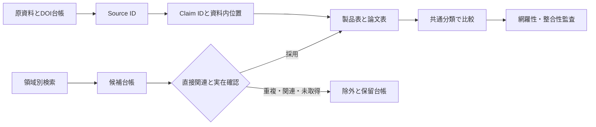
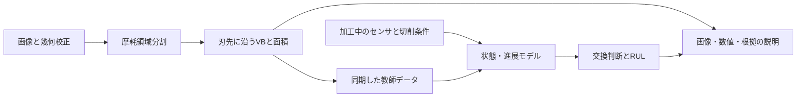

# 国内外の工具摩耗判定技術ベンチマーク

調査基準日：2026年10月20日（日本時間）。公開資料に基づく初回調査版。

## 1. エグゼクティブサマリー

商用候補51名称を探索し、33製品・系列を比較表に採用した。内訳は商用28、計測・欠損検知等の関連機能3、販売終了または現状未確認2である。国内11、海外22。学術研究は59本を採用し、本文の方法・評価該当節を確認できた25本と、抄録・本文抜粋に確認が限られる34本を区別した。件数目標は満たしたが、探索の飽和や全工具・地域の網羅性は確認できていない。

技術選定で最も重要なのは、必要な出力を先に決めることである。**加工中の異常停止、摩耗種類の分類、VBの寸法測定、交換判断、RUL予測は別の課題**であり、共通の「精度」で順位付けできない。商用ではNC連携・しきい値・基準波形・光学測定が多く、学術では画像分割、時系列、転移・ドメイン適応、自己教師、物理制約の検討が広がっている。

特に重要な確認事項は次のとおり。

- **モリマシナリー**：現行製品のAI機能、共同特許のEfficientDet構成例・TTA、岡山大学のYOLO＋PatchCore＋EfficientNet研究を確認した。ただし販売版と具体モデルの一致は未確認。AIツールソムリエを独立製品として重複加算しない。
- **Sandvik Tool Wear Analyzer**：撮影画像を画像庫と比較・計測する人の判断支援。AI自動分類やCNN搭載は確認できない。CoroPlus ProcessControlはセンサ監視で別製品として扱う。
- **HEIDENHAIN VT122＋VTC1.6**：AIによるエンドミル逃げ面摩耗幅の自動測定を公式資料で確認。標準測定精度±20 µmと分解能5 µmは異なる。ボール・トロイド工具の撮影対応から自動摩耗測定対応を推測しない。
- **学術の数値監査**：SAM関連2研究の「IoU」数式がDice型、工具全寿命最大値による正規化、test MSEでの構造選択などを発見。高い報告値をそのまま現場性能に置き換えられない。
- **R&D優先案（調査者評価）**：まず摩耗領域＋VB計測の再現性、工具個体・条件・工場を分離した外部検証、少数ラベルでの適応を進める。VLMの説明生成は、校正済み測定値と原画像を根拠として後段に置く構成が検証しやすい。

主要根拠：[モリ公式](https://mori-machinery.com/product/tool-sommelier)（P0001/2）、[共同特許](https://patents.google.com/patent/JP7548520B1/ja)、[岡山大論文](https://doi.org/10.1299/transjsme.24-00127)（R0115）、[Sandvikアプリ登録](https://play.google.com/store/apps/details?hl=en&id=com.sandvik.coromant.toolwear)（P0101）、[HEIDENHAIN仕様書](https://news.heidenhain.com/fileadmin/pdf/ja/Produktinformation/PI_VT121_ID1324220_ja.pdf) pp.5,7（P0119）。

## 2. 調査目的・方法・調査範囲

目的は研究開発者が、既存商用品の機能範囲と公開技術、研究の実験的到達点、未検証の一般化性能を分けて判断できるようにすることである。原則2015年以降を対象とし、実行日以前に確認できる公開資料を使用した。最新版という名称だけで出荷・契約状態を断定せず、現行ページ、発表、研究実証、歴史資料を区別した。

商用は工具・工作機械・工具測定・画像検査・TCM・AI企業を探索し、メーカー、カタログ、開発発表、特許、公的研究事業、共同論文の順で補完した。論文はWeb検索、出版社、Crossref API、J-STAGE、CiNii、arXiv、大学・機関リポジトリ、レビューの参考文献を利用した。Google Scholar、OpenAlex、IEEE Xploreの直接検索を網羅的に実施したという意味ではない。出版社の検索結果抜粋は、全文取得と扱わない。

製品表は44指定項目に実装モデル・研究モデル・関連根拠等を追加し49列、論文表は44指定項目に主カテゴリ・採用区分・発行年注記等を追加し48列とした。空欄・ゼロで不明情報を補完しない。URL重複のSource IDは別名対応表にまとめ、Claim→Source→資料位置を維持した。

確度Aは対象商用品の技法が明示、Bは関連研究・特許のみ、CはAI/ML使用のみ、Dは判定方式未確認を表す。Aには手動支援、レーザ計測、閾値監視も含むため、Aを「高度なAI」「固有アーキテクチャ公開」の意味で読んではいけない。

## 3. 商用製品・ソリューションの全体像

| 機能群 | 代表例 | 主入力・出力 | 選定時の確認点 |
|---|---|---|---|
| 画像の判断支援 | Sandvik Tool Wear Analyzer | 工具画像・画像庫→比較・計測・記録 | 自動分類の有無、倍率と校正 |
| 画像AI | TOOL COLLAGE、VT122＋VTC1.6 | 工具画像→欠け/摩耗、または刃別VB | 何を自動出力するか、対応工具、学習主体 |
| 光学2D/3D・レーザ | BLUM、Renishaw、ZOLLER、Alicona | 遮光/3D形状→輪郭・摩耗寸法 | 分解能、繰返し性、真値との差、清掃 |
| NC・電力・力の工程監視 | Nordmann、Montronix、TMAC、ARTIS、ToolScope、WattPilote | 基準信号との差→摩耗/欠損警告・停止 | 工程変化と摩耗の識別、NC互換、監視限界 |
| センサと状態情報基盤 | spike/fusion、iTENDO²、MULTI INTELLIGENCE | 力/振動→トレンド・状態情報 | 計測のみか判定まで含むか、RULの定義 |
| CNC内蔵/連携AI・統計 | OSP-AI、NC MachiningAID、iQ Monozukuri、Komtas、TIMS | CNC内部信号→診断・寿命管理 | 対応NC・加工・材料、教師データ、制御動作 |

表は選定用の機能群であり市場シェア分布ではない。28商用品の公開資料も、全てが摩耗量の自動測定を意味しない。Haas BTDは前後画像の工具長差による欠損検知を中心とする関連機能、AP-10F/AP-SH05は販売終了、CoroPlus ProcessControlは歴史資料から機能を確認し現在の契約可否を未確認とした。各製品の根拠はExcelのP0001–P0122とSource IDを参照。

国内外の配分は11/22だが、海外は欧州メーカーの資料が多い。追加検索で中国の深圳華刃、台湾の東台TIMS、韓国Seungbinを加えた。アジア全域を十分に網羅したという結論には至らない。**全製品の個別市場規模・実売価格・売上は確認できず、工具市場やTCM市場全体の数字を転用していない。**

## 4. 主要商用製品の技術的特徴

### 4.1 モリマシナリー：製品・特許・研究の三層

| 層 | 確認できた内容 | 製品搭載に関する判断 |
|---|---|---|
| 現行公式製品 | TOOL COLLAGE単体購入、工具画像、AIの欠け/摩耗検出、利用者ごとの学習。φ2mm以上でも変位量依存 | AI機能は確認、固有モデル名は未確認 |
| 共同特許JP7548520B1/WO2024247331A1 | 方向別M1–M4、EfficientDet構成例、TTA、他検出/分割方式の選択肢、実施形態にTOOL COLLAGE | 関連性あり。採用仕様書ではないためB |
| 岡山大学2024論文 | TOOL COLLAGEで撮像、YOLO切出し、PatchCore外観異常、電流recurrence plot＋EfficientNet、判定併用 | 撮像装置使用の根拠。内蔵AIの根拠ではない |
| Go-Tech/2023共同発表 | 画像深層学習、分散学習、電流特徴量の勾配ブースティング/時系列研究 | 研究要素を現行版の全機能としない |

2023年共同発表の欠陥検出85%以上・摩耗予測70%以上は研究実証値で、現行製品の保証精度ではない。資料には2018年より開発・販売と2019年より提供の両記載がある。発売年は矛盾を保持する。将来売上目標も売上実績や市場規模に読み替えない。[共同発表](https://www.okayama-u.ac.jp/up_load_files/press_r5/press20230602-1.pdf) pp.2–5、[Go-Tech](https://www.chusho.meti.go.jp/sapoin/index.php/cooperation/project/detail/4825)、[特許](https://patents.google.com/patent/JP7548520B1/ja)。CJP001–CJP012および追加特許Claimを参照。

### 4.2 Sandvik：人の画像確認とセンサ監視

Tool Wear Analyzerのメーカー登録説明は、工具画像を参照画像庫と比較し、計測・保存・共有する流れを説明する。したがってCNN/YOLOの自動摩耗分類器とは記載しない（CG001–CG006）。CoroPlus ProcessControlは加工信号による摩耗・欠損等の監視、停止・工具交換との連携を説明するが、具体モデルと現在提供範囲は未確認である。傘下pro-micronのspike/fusionには摩耗トレンド、THI、RUL Calculator等の機能が見られるが、画像からの摩耗幅測定や物理寿命予測の誤差保証と混同しない。[Sandvik年報のProcessControl事例](https://www.annualreport.sandvik/en/2018/operations/sandvik-machining-solutions/customer-case.html)。

### 4.3 HEIDENHAIN、NC連携、従来計測

VT122＋VTC1.6は低速回転で撮影した全周パノラマから、学習済みAIで刃別の逃げ面摩耗幅を自動測定する。公式日本語資料は社内大量画像による学習、数秒、標準精度±20 µmを説明するが、CNN等の構造、評価母数、未知工具の誤差は未確認。撮影・寸法測定・摩耗測定・AI自動化の対応表を別々に読む必要がある。2025-09-11は追加機能の発表日で、販売開始年を意味しない。[公式発表](https://www.heidenhain.de/news/presse/ki-basierte-verschleissmessung-mit-vt-122-und-visual-tool-check)、[仕様書](https://news.heidenhain.com/fileadmin/pdf/ja/Produktinformation/PI_VT121_ID1324220_ja.pdf) pp.5,7（CG130–CG140）。

OSP-AIの2018共同発表にはNEC RAPID採用、iQ Monozukuriには重回帰・σ逸脱等、KomtasにはNC信号の特徴量と閾値が記載される。Komtasのドリル/リーマ専用アプリは、リーマという対象範囲を明示できた商用例である。TMACの2026資料にはMLによる監視限界自動調整があるが、固有モデルは未確認。これらは新しい画像モデルと同じ課題を解いているとは限らず、工作機械への統合と運転中の処置が強みとなる（P0003–5/P0011/P0108）。[NEC共同発表](https://jpn.nec.com/press/201810/20181029_03.html)、[Komtas技報](https://www.komatsu.jp/en/-/media/home/aboutus/innovation/technology/techreport/2022/en/175-e06.pdf)。

## 5. 学術研究の全体像

| 主カテゴリ | 件数 |
|---|---:|
| Domain Adaptation | 2 |
| LSTM・GRU・時系列 | 4 |
| Transformer/ViT | 9 |
| 特徴量ベースML | 11 |
| センサ信号解析 | 3 |
| マルチモーダル・センサ融合 | 4 |
| 自己教師あり学習 | 3 |
| 転移学習 | 1 |
| Few-shot／Zero-shot | 3 |
| 物理モデル・AI統合 | 2 |
| 物理モデル | 2 |
| One-class/異常検知 | 1 |
| CNN | 3 |
| 従来画像処理 | 1 |
| 物体検出 | 1 |
| Foundation Model（画像分割） | 3 |
| セグメンテーション | 6 |

主カテゴリは1論文1分類とし、転移・自己教師・融合などの併用は別の技術カテゴリ列に残した。したがって、例えば「CNN」分類数だけをCNN利用論文の総数と解釈しない。画像系のSAMには言語生成がなく、Foundation ModelとVLMを分けている。

対象はミリングが中心で、旋削・穴あけ・タップ・深穴中ぐり・歯切り・木材切削も含む。日本所属を一次資料で確認できた採用は5本で、国内文献の体系的探索はなお不足する。国籍を著者名から推定しておらず、所属所在を未確認とした行もある。PHM2010等のセンサベンチマークへの依存、少数の実工具から多数の窓画像を生成する実験が目立つ。

## 6. 代表的な研究手法

| 研究 | 役割と到達点 | 評価条件・限界 |
|---|---|---|
| R0102 Wu2019 | ToolWearnet分類＋輪郭処理でVB計測。分類平均precision96.20%、VB MAPE約5% | Inconel718、70/15/15、寿命系列を分割。検出mAPではない |
| R0125 Holst2022 | 工具有無CNN→U-Net→VB幾何算出 | 100%は工具存在、Dice0.85は領域、R²0.99は寸法相関。全て別指標 |
| R0117 Schlager | U-Netのloss/拡張/tile寸法を比較 | 24元画像中4枚holdout。IoU0.886/0.904は512/256tile。反射・合成境界に偽陽性 |
| R0106 Singh2026 | 実工具画像ViT-Largeで複合摩耗4状態 | 元200枚、通常40枚97.50%、独立insertの照明変更80枚96.25%。未知工場は未評価 |
| R0109 Li2025 | SAMをLoRA/MoE-LoRA適応、12工具977画像 | 各type内分割、3点で著者表記IoU0.914。数式はDice型で定義要確認 |
| R0120 Islam2025 | SAM/HQ-SAMを追加学習せず幾何校正・差分で計測 | 未査読。乾式、相対誤差3.81%、0.572秒/画像。prompt・校正不要ではない |
| R0001 Cai2025 | 非定常Transformer＋複数sourceドメイン適応 | 9工具/9条件、27転移課題平均93.22%。適応時にtarget未ラベル信号を利用 |
| R0014 Gittler2021 | disentangled VAEによる自己教師表現 | 実工場まで評価するが説明分散等の値を分類Accuracyとしない |
| R0021 CSAKansformer2026 | 信号画像・KAN/注意の軽量な状態分類 | 全寿命最大値正規化・寿命割合クラス。将来情報なし再評価が必要 |
| R0029 tapping2025 | 半教師ありでラベル費用削減 | 36tap/7000超ねじ。Go/No-Go品質の代理判定でVB回帰ではない |

原資料：[Wu](https://doi.org/10.3390/s19183817)、[Holst](https://doi.org/10.1016/j.ifacol.2022.04.249)、[Schlager](https://doi.org/10.1007/s10845-023-02313-y)、[Singh](https://doi.org/10.3390/machines14060589)、[Li](https://doi.org/10.1016/j.procir.2025.02.184)、[Islam](https://doi.org/10.21203/rs.3.rs-6975138/v1)、[Cai](https://doi.org/10.3390/s25061742)、[Gittler](https://doi.org/10.1504/ijhm.2021.114174)、[CSA](https://doi.org/10.3390/s26102937)、[tapping](https://doi.org/10.1007/s00170-025-16491-x)。詳細は `details/papers_image.md` と `details/papers_sensor.md`。

これは調査者が作成した概念図で、特定製品の内部構造を示すものではない。直接画像計測は、間接監視の教師値を作る役割も持つ。

## 7. 技術方式別の比較

| 方式 | 主入力・出力 | 学習データと速度 | 汎用性・導入・主要課題 | 商用化との対応 |
|---|---|---|---|---|
| しきい値・基準波形 | 電流/力→逸脱・停止 | 正常加工の基準。オンライン向き | 条件変更を摩耗と誤認し得る。NC連携が必要 | 多数のTCMで確認 |
| 従来画像処理 | 校正画像→輪郭/寸法 | 学習不要も可能。処理は軽いが撮像時間別 | 照明/凝着/形状でルール再調整 | 光学計測、研究R0103 |
| 特徴量ML | 手設計特徴→分類/回帰 | 比較的小規模で試せる。特徴設計コスト | 条件との交絡、移植性 | 統計技法は公開例あり。固有学習器未確認製品も多い |
| CNN画像分類 | 工具画像→状態 | クラスラベル、事前学習を活用可能 | 未知形状への失敗、状態と量を区別 | 商用画像AIは存在するがCNN搭載の確認例は別途必要 |
| YOLO検出 | 画像→bbox/欠陥位置 | bboxラベル。高速でも全工程時間を確認 | 微小欠損、bboxからVBは直接出ない | 関連特許にあり。製品採用未確認 |
| U-Net等分割 | 画像→pixel mask→VB | 高価なpixelラベル | boundary/尺度/凝着と真摩耗の識別 | 研究で具体構造公開、商用内部は不明な場合あり |
| ViT | 画像または信号画像→状態 | 事前学習と元画像数の区別 | 工具個体・照明・工場の外部検証が必要 | 具体モデル搭載を確認できず |
| SAM適応 | 画像＋prompt→mask | 固定重み、LoRA、擬似ラベル等 | promptの真値依存、微小領域、指標不整合 | 直接工具研究あり、商用搭載は未確認 |
| 時系列/RUL | 加工履歴→摩耗/RUL | 寿命末期までの教師系列が重い | 条件変化、急破損、将来情報漏洩 | RUL表示製品はあるが算出法・精度は別確認 |
| 自己教師・Few-shot・DA | ラベル削減/条件適応 | 未ラベル・少数targetデータ | 真のzero-shot、targetアクセス、適応時間を明示 | 公開論文先行、製品方式との同定困難 |
| 融合・物理AI | 画像/信号/条件→複数出力 | 同期・校正・物理パラメータ必要 | ノイズ・欠測・センサ交換、制約の妥当性 | 複数センサ商用はあるが、論文構造との一致未確認 |
| VLM説明 | 画像＋校正値＋工程文脈→言語 | 根拠付き回答の評価データ必要 | 流暢さと測定正確性・原因同定を区別 | 本調査で基準日適合の直接採用論文を確定できず |

上表の汎用性・難易度は調査者の比較評価で、保証性能ではない。方式別の全11観点は `reports/technology_comparison.csv` に分けている。精度列には単一の順位スコアを作らない。

## 8. 技術の進化・年表

| 時期 | 採用研究での例 | 商用側で確認した例 | 読み方 |
|---|---|---|---|
| 2015–2017 | PCA/SVR、RF、形状SVM、接触抵抗、ANN | 発売時点を確認できないTCMをこの時代に割り当てない | 特徴・物理センサは現在も有効 |
| 2018–2019 | 画像/ANN寿命、ToolWearnet、CNN-BiLSTM | 2018 OSP-AI共同発表、モリ開始年2018/2019両記 | 発表年と販売年は別 |
| 2020–2022 | 複数工具FCN、U-Net計測、時系列、自己教師 | NC・光学・基準監視と並存 | CNNから全てが置換されたわけではない |
| 2023–2024 | 検出＋分割、画像/電流融合、SAM prompt | 2023モリAI実証、商用版との差を保持 | 研究実証と発売を混同しない |
| 2025 | LoRA-SAM、SAM擬似ラベル、DA、未ラベルGNN | 2025 VTC1.6 AI摩耗測定機能の発表 | モデルの世代と現場価値は独立 |
| 2026～基準日 | 実画像ViT、Few-shot生成、物理AI、画像音響融合 | TMAC+AI資料、NC連携の拡張 | 原著のデータ独立性と製品保証を監査 |

この表は本調査で確認した例の配置であり、各技法の世界初の年ではない。2027年1月号のQwen3-VL-8B工具摩耗論文候補（DOI:10.1016/j.ress.2026.113287）は、基準日前のonline公開日を確定できなかったため採用を保留した。DOI中の2026を発表年と断定しない。

## 9. 商用製品と研究技術のギャップ

商用品は監視限界設定、加工状態の切出し、清掃、カメラ位置、NC停止、工具データ管理、保守などを含む工程として提供される。論文の推論精度が高くても、画像取得や洗浄時間を含む総サイクル、誤停止率、交換しなかった時の損失、継続校正は評価されていないことがある。YOLO改良論文R0105の7.6秒は合成画像の検出処理、撮像からは13–15秒であり、FPSだけでは工程時間を判断できない。

一方、商用品には公開のAccuracy/F1やVB誤差が少なく、比較条件を揃えにくい。固有モデルを確認できないことは技術力の低さを意味せず、公開資料の情報不足を意味する。確度分布はA22/B2/C6/D3だが、Aには非AI方式が含まれる。

研究先行として具体構造を確認できたのは、SAM/LoRA、擬似ラベル、少数ラベル適応、画像と信号の深い融合、物理制約型学習などである。ただし「研究先行」は当該商用採用が公開確認できないという意味であり、世界に商用品が存在しないとの断定ではない。

## 10. 技術的な限界

| 限界 | 原資料で確認した例 | 実装前の検証 |
|---|---|---|
| 指標名・式の不一致 | R0109 Eq3/R0110 Eq1がIoU表記でDice型 | マスクからIoU/Diceを独立再計算。原値は改変せず保持 |
| 寿命後半の情報依存 | R0021は全寿命最大値で正規化 | 学習工具統計または因果的オンライン統計だけで再評価 |
| testによるモデル選択 | R0013にtest MSEで構造選択の記述 | 外側工具holdout＋内側検証、最終testを固定 |
| 代理指標 | R0029はねじ品質、R0107は加工面画像、R0119は7故障分類 | 実測VB/故障原因/品質の各ラベルを分ける |
| 小規模独立試料 | R0106元200枚、R0117元24枚 | augmentation後枚数と独立工具数を併記 |
| source依存のprompt | R0109でmaskから点を生成 | 推論時に実際に取得可能なpromptで評価 |
| 原資料内部不整合 | R0108の17工具と13工具リスト、R0012の5minと456000ms | 著者データ/コードで照合。推測で修正しない |
| 幾何・照明・汚れ | R0112の形状移植失敗、R0117の反射偽陽性 | 工具形状・コーティング・照明・冷却液ごとの外部test |
| 原因推定の不足 | Grad-CAM等は注目領域であり因果実験ではない | 切削条件や冷却・材料を介入して原因を検証 |

監査は査読論文の否定ではなく、用途を限定して正しく読むためのもの。R0110/R0109のIoU数式の指摘は調査者の数式照合による評価であり、原著による訂正済みという意味ではない。主要Claimと資料位置は台帳に記載した。

## 11. 今後の研究開発機会

以下は公開資料から導いた提案で、達成済み性能や事業効果の予測ではない。全評価項目は `reports/research_opportunities.csv` に記載した。

| テーマ | 到達点・未解決課題 | 想定アプローチと必要データ | 検証方法 | 難易度・期待効果 |
|---|---|---|---|---|
| 1 複数工具の汎用判定 | 複数工具分割は存在、未知形状に弱い | 形状別座標正規化＋CNN/U-Net/SAM比較。工具・材種・被膜を横断した実画像とVB | leave-one-geometry-out、工場外部test | 高。工具追加時の個別開発を減らす |
| 2 再学習削減 | 事前学習は有効だが条件ごと再調整 | 校正を固定し特徴量ML/CNN/LoRAを同じデータ量で比較 | 学習枚数・工数・誤差の曲線、既存工具の忘却 | 中～高。導入準備期間を削減 |
| 3 Few-shot新工具対応 | SAM/LoRA/MAML等が候補 | 支援例だけを適応に使う。新工具の正常/摩耗/欠損少数例 | 未知工具を外側holdoutしsupport/queryを別工具個体に | 高。小ロット工具の対応を拡張 |
| 4 種類分類と量測定 | ToolWearnet等に二段構成 | multi-head領域＋種類＋幾何計測。重複摩耗、BUE、欠損を個別ラベル | class F1、境界精度、VB MAE、校正不確かさ | 中～高。交換判断の根拠を明確化 |
| 5 VLMによる説明 | 直接候補あり、基準日適合未確定 | 測定器出力・領域・工程条件を根拠として言語化。熟練者の理由付きラベル | 根拠一致率、数値誤記率、危険な見逃し、回答保留 | 高。判断共有。ただし測定は別途保証 |
| 6 摩耗領域自動抽出 | U-Net/SAMの直接研究あり | 自動prompt生成と境界補正。校正済み顕微鏡、pixelラベル、凝着別ラベル | IoU/Diceを独立算出、VB誤差、prompt生成失敗率 | 中。測定と教師データ作成を効率化 |
| 7 画像・信号・条件統合 | 岡山大・MATWI融合例 | 時刻と刃単位を揃える。画像、NC、力/AE、切削条件、実測VB | 単独入力/融合の同一split比較、欠測・ノイズtest | 高。運転中監視と直接測定を相互補完 |
| 8 工場変化への頑健性 | DAと照明testがある | 校正標準、ドメイン適応、不確実性/保留。別設備・カメラ・湿式データ | 未知工場、経時drift、誤停止/1000工程 | 高。再設定頻度と誤停止を減らす |
| 9 熟練者とAI協調 | 人の画像比較支援、研究で熟練者ラベル | AI信頼度と画像領域を提示し訂正を記録。複数判定者と刃別ラベル | 判定者間一致、時間、見逃し、工具利用率を盲検比較 | 中。ラベル品質と運用納得性を改善 |
| 10 RUL展開 | LSTM/物理AI/商用RUL表示 | 因果的履歴＋VB＋交換理由、予測区間、急欠損別モデル | 寿命末期の外部test、時間誤差、区間coverage、損失 | 高。過早交換と不良リスクの両立 |

R&Dの初手としては、**校正・ラベル単位・評価分割の共通化**を推奨する。モデル比較は従来画像処理、形状/統計特徴＋RF/SVM、転移CNN、ViT、SAM/LoRAを同じ独立工具で行う。学習データ量、測定誤差、撮像を含む総時間、誤停止、再設定工数で判断し、モデル世代を有望度の代理にしない。

## 12. 調査網羅性・制約

33商用比較対象と59論文は調査時点の公開資料版である。主要方式は広く探索したが、以下は残る。

1. 採用論文のうち34本は抄録/抜粋に限定され、全59本の精度・分割を完全には埋めていない。深さの目標は未充足である。
2. 複合加工、ラジアスエンドミル、リーマの学術直接適用、国内学会・特許の引用追跡、地域別の独立供給者は追加探索が必要。
3. CLIP、DINO/DINOv2、SAM2、LLaVA、Qwen-VLについて、本調査で直接工具摩耗に適用された基準日適合研究を確定できたと主張しない。Qwen3-VL候補、一般工業SAM2、石器DINOv2は別台帳に保持した。
4. メーカーへの問合せ、有料本文の購入、各データ/コードの再実験、特許原簿の全件照合は未実施。
5. 検索の総ヒット数は多くが未提供。検索別採用数の割当と初期の分秒記録には欠落がある。返却数・保存時刻・候補台帳を区別して記録した。
6. 著者の国籍・製品別市場規模・価格・非公開モデルを推測しない。未発見は不存在の証明ではない。

追加地域検索と工具別検索で新しい直接研究が見つかったため、**探索は飽和していない**。追加候補も台帳に残し、件数達成だけで完全網羅を宣言しない。分布、未確認、除外理由、参照整合は [網羅性・品質監査](coverage_and_quality_audit.md) と [カバレッジ表](../evidence/coverage_matrix.csv) を参照。

## 13. 参考資料・成果物

- [商用比較CSV](../outputs/commercial_tool_benchmark.csv) / [Excel](../outputs/commercial_tool_benchmark.xlsx)
- [論文比較CSV](../outputs/academic_paper_benchmark.csv) / [Excel](../outputs/academic_paper_benchmark.xlsx)
- [出典台帳](../evidence/sources.csv)、[主張](../evidence/claims.csv)、[主張と根拠](../evidence/claim_evidence.csv)
- [検索ログ](../evidence/search_log.csv)、[除外・保留](../evidence/excluded_candidates.csv)、[未確認事項](../evidence/unverified_items.csv)
- [国内製品詳細](../details/products_japan.md)、[海外製品詳細](../details/products_global.md)、[画像系論文詳細](../details/papers_image.md)、[センサ系論文詳細](../details/papers_sensor.md)

本文に示したIDは比較表と台帳の結合キーである。全参考文献は出典台帳にURL、資料種別、確認深度、保存先、資料内位置を付して収録した。図は独自概念図のみとし、原著のモデル図・判定例は詳細シートに示す図表番号と原資料リンクを参照する。
